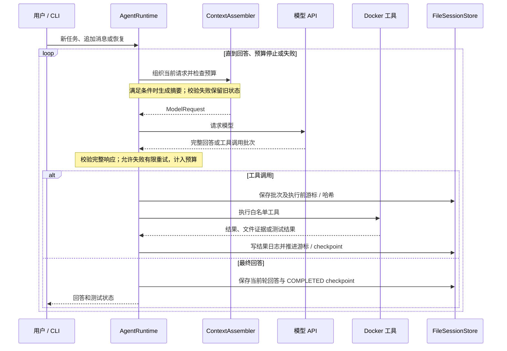
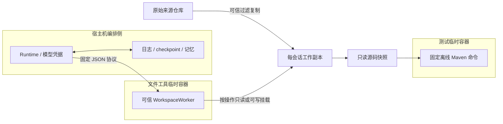

# 架构与设计取舍

项目以同步、单工作线程运行一个会话。模型负责选择动作，Java 运行时负责执行顺序、预算、证据和持久化。当前模型适配器使用非流式、非思考模式的 Chat Completions 工具调用协议。

## 模块职责

| 模块 | 主要类 | 职责 |
| --- | --- | --- |
| 入口 | AgentApplication、AgentOptions、InteractiveSessions、TerminalChat、AgentConfigLoader | 选择新任务、追加需求、恢复、查询或导出；装配依赖 |
| 编排 | AgentRuntime、AgentSession、PendingToolBatch | 主循环、工具批次游标、用户轮次和会话状态 |
| 上下文 | ContextAssembler、ContextCompactor、ConversationCompactor | 请求组织、完整预算、两类摘要及降级 |
| 模型 | DeepSeekModelClient、ModelRequest、ModelResponse | 编码请求、校验响应、解析工具参数与安全诊断 |
| 工具 | tools 包 | 文件操作、测试、记忆和历史检索 |
| 隔离 | DockerWorkspace、WorkspaceWorker、DockerSandboxExecutor | 固定协议的文件容器、固定命令的测试容器 |
| 存储 | FileSessionStore、SessionCheckpoint、ObservationArchive | 日志、检查点、原始工具证据及恢复核验 |

## 终端输入与执行分离

`--interactive`由AgentOptions识别为无值开关。新会话先读取第一条需求，再创建AgentSession与工作副本；已有COMPLETED会话直接进入提示符。TerminalChat只负责输入、命令、简短输出，通过Runtime工厂按当前累计上限执行。

CREATED调用run，COMPLETED收到新需求调用continueConversation，BUDGET_EXHAUSTED/FAILED在用户主动恢复时使用已有恢复入口；终端 `/open` 只加载，不自动执行。每次执行后保存快照；额度耗尽或当前轮失败不接受新消息。`/budget`改变本进程累计上限，不清空历史或额度统计，也不改变API输出预算。退出释放会话锁，后续可从checkpoint重新接入。

## 会话选择、写回与删除

终端会话选择由 InteractiveSessions 管理。每个 Attachment 拥有 AgentSession、独立 FileSessionStore、绑定当前 workspace/archive/session 的工具与 runtimeFactory、WorkspaceSynchronizer 和调用上限。生产环境只保留一个活动附件；候选会话完成校验后才替换旧附件并释放锁，重新进入旧会话时从它自己的 checkpoint 恢复。共享的 ModelClient 只负责无会话状态的HTTP请求，消息由当前 AgentSession 组装。/open 不执行模型或工具恢复，未完成轮需用户 /resume。

删除生命周期由 FileSessionStore.prepareDeletion 和 SessionDeletion 管理：使用正常会话锁保护预览、确认和目录移除；只允许删除 UUID 定位的非当前会话目录。目录原子移出公开 UUID 路径后，递归清理不跟随符号链接。删除确认属于终端命令输入，不进入 AgentSession 对话历史；原项目不参与删除。未写回提示复用 WorkspaceSynchronizer 的比较规则，无法核验时报告未知。

会话选择成功后释放旧锁；失败则保留旧会话。`/new` 从原项目创建新副本，未写回的旧修改不会随之复制。显式写回位于宿主机可信同步层，文件工具仍只操作副本；两个会话写回同一文件时，各自基准哈希防止相互覆盖。

## 执行链路



每次模型响应可包含多个工具；运行时依次执行，保留完整批次。需要上一条工具结果的调用由模型在后续请求中提出。模型不会直接执行 Java 代码；`ProcessBuilder` 启动固定 Docker 命令，容器里的 worker 或 Maven 才执行文件操作或测试。

## 上下文：两个摘要维度，共用一份原始工具历史

| 信息 | 默认组织方式 | 原始内容 |
| --- | --- | --- |
| 当前用户轮 | 完整保留当前需求与执行历史中选中的批次 | 会话状态与日志 |
| 工具历史近期 | 短历史不超过 12 个完整批次且过滤后正文放得下预算时完整保留；长历史保留最近 4 个完整批次，受预算限制 | 原结果日志 |
| 工具历史中期 | 前 8 个批次候选，累计 4 个新合格批次时尝试增量摘要；尚未由成功摘要处理的部分在预算允许时继续保留原文 | 原结果日志 |
| 对话近期 | 当前轮及最近 2 个完成轮次保留原消息 | ConversationTurn 与日志 |
| 对话中期 | 前 8 个完成轮候选，达到 4 个新合格轮次时尝试摘要 | 原始用户消息与回答 |
| 更远历史 | 原始正文退出默认窗口，已摘要的有效关键结论可继续参与检查点更新，详情按需检索 | 文件归档保留；部分内存元数据仍存在 |

工具摘要 `ContextSummary` 记录操作与观察；对话摘要 `ConversationSummary` 记录用户要求、修改关系和当时回答。两者分别保存，不把用户约束混成工具结果。工具记录跨用户轮次沿用同一份历史，没有按轮删除旧执行结果。

为保持工具消息的对话顺序，拥有当前选中工具批次的旧用户轮次可能仍保留原文；近期保留策略也受完整请求预算约束。因此不是严格按轮数切断所有文本。

已经成功摘要并覆盖的原始记录不会作为新原文反复输入；后续输入由旧摘要与新增合格原文组成，允许对旧摘要做合并。失败候选不安装，之后按原间隔重试。正文不足默认 2048 字符跳过模型摘要，避免短记录摘要反而增大。

上下文投影策略版本 6 保存当次使用的 `summaryCoveredExchanges`，只取成功安装摘要的处理边界，不把尝试或跳过边界当成摘要成功。中期未处理原文仍按完整工具批次保留，原文最多覆盖最近 12 批次，实际数量受字符预算和完整请求预算限制。若未处理记录仍因窗口或预算退出正文，索引会标注 `UNSUMMARIZED_OMITTED` 和 `NOT_SUMMARIZED`，优先列成功写入；索引总额仍为 2000 字符，可能不完整，应通过历史工具检索。此索引不是模型摘要，也不恢复过期正文。旧版本 1–5 的 checkpoint 仍按各自策略重放。

这一步解决待摘要原文提前不可见的问题，不保证每条记录都生成模型摘要，也不保证成功摘要永久可见。新原文候选仍受中期范围限制；旧摘要中未过期的有效结论可跨窗口继续整合，摘要整体受时效性与预算限制；本轮关键操作退出所有可见区域后仍可能被模型遗忘，需要另外保存本轮操作事实。

摘要须使用真实来源 ID 和连续原文引句，禁止新建 NEXT_STEP，验证大小、收益、覆盖范围与时效性后才安装。工具摘要还做保守去重。 新版摘要固定为 `CONSTRAINTS`、`FINDINGS`、`CHANGES_AND_TESTS`、`OPEN_ISSUES` 四个章节，空章节保留。新检查点整体替换旧检查点；提示词要求合并状态变化、吸收用户纠正、移除已替代规则和已完成待办，不新增下一步。模型输出仍需来源核验，不能保证语义完全正确。引句验证证明来源存在，不保证摘要推论正确；拒绝后保留原摘要，使用规则裁剪继续。

工具历史摘要输入提供请求内的证据编号（如 `E1`）。Java 从可见且能匹配原始结果的连续片段构建证据列表，模型按固定章节返回 `statement` 和 `evidenceId`；适配器按编号填入现有 `SummaryNote` 的来源及原文引句。旧摘要引用也映射到本次编号。编号只在本次调用内有效，不持久化为历史来源。整批校验通过后才安装摘要，不接受部分条目来推进覆盖位置。对话摘要也采用请求内证据编号，由 Java 从原始消息或旧摘要补回来源和引句。

拒绝诊断记录安全原因、条目下标（从 0 开始）和实际数量，例如 `NOTE_COUNT`、`NOTE_FIELDS`、`UNKNOWN_EVIDENCE_ID`；不保存原始模型输出、未知字段值或异常文本。证据匹配仍不等于语义正确，压缩收益与完整请求预算也仍须通过检查。

完整请求预算覆盖系统提示、工具定义、两类摘要、原始消息、工具结果、JSON包装及输出预留。UTF-8 字节数作为保守输入估算，与真实计费 token 有区别。

上下文投影策略 v4 先过滤过期证据，再判断短历史能否完整保留。最近 12 个批次的原始结果保留在会话内存中，超过后仍卸载远期长正文。历史索引最多 2000 字符，新增路径、successful、validity：CURRENT 表示有文件指纹证据且未被托管写入失效，STALE 表示已失效，无可验证证据为 UNKNOWN。CURRENT 不是永久有效保证，历史提取仍执行现有核验。保留了原文的摘要条目不重复发送，持久化摘要不修改。旧投影 v1–v3 按原规则校验恢复，新请求采用 v4。

## 证据时效性与历史检索

读取、搜索及写入相关证据携带文件指纹；测试记录关联工作区 revision。写入后旧文件证据失效，工作区版本递增，旧测试标为过期。历史操作的发生事实仍存在，但旧正文默认从当前请求隐藏。

| 工具 | 作用 |
| --- | --- |
| search_history | 按工具、路径或字面关键词找历史调用 ID、匹配行和时效性 |
| read_observation | 按调用 ID 提取历史结果原文；历史行号不等于当前文件行号 |
| search_turns | 检索旧用户消息或回答，返回消息 ID 与后续轮次提示 |
| read_turn | 提取原对话；返回 HISTORICAL_ONLY 标记，不提升为当前约束 |
| remember_fact | 保存带工具来源和引句的工作记忆；加载时复核 |

主动检索到的旧证据进入独立、有界的历史证据区，避免刚取回就被默认过期过滤隐藏。需要当前文件内容或测试结论时必须重新读取或运行测试；存在后续用户轮次不代表所有旧约束都已撤销。

## 容器与存储边界



文件容器普通用户运行、禁联网、只读根文件系统、限制 CPU/内存/进程；模型不能选择镜像、挂载和任意命令。API 配置、会话日志、Docker socket 和宿主机 Maven 缓存不挂载。测试依赖来自镜像预装仓库，源码快照只读，构建输出位于容器内。

源码副本持续保留，每次工具调用的容器结束即销毁。来源仓库不自动同步。用户通过 `/diff` 查看改动、`/apply` 显式写回，或导出到新目录。`WorkspaceSynchronizer` 是可信宿主机同步组件，不向模型暴露写回工具；基于原文/上次同步哈希检查冲突，并将成功同步哈希保存在 source-sync.json。同步不修改隔离副本、模型历史或 checkpoint 状态。

## 验证依据与完成校验

本轮通过 `pin_verification_basis` 从成功 `read_file` 中固定已展示的契约行，核验来源与当前 SHA-256；最多 8 份、合计 6000 字符，每份最多 100 行和 1600 字符。普通历史窗口裁剪不会立即移除这些依据，但它们计入完整请求预算。准备请求时重查工作区哈希；过期或未知依据隐藏正文，只保留来源和失效提示。

`current_turn_verification` 在模型请求中单独呈现契约原文、最近测试的分类/失败方法/expected/actual及完成拒绝原因。模型根据契约直接编写断言，不需要登记期望值；算术推导可按需使用有界整数计算工具，程序不证明业务推论正确。失败应先回查契约，再判断修改实现、测试或处理环境阻塞。

运行环境提供 `run_tests` 且本轮有成功写入，或本轮已经尝试过 `run_tests` 时，模型的 `FINISH` 需经过 `CompletionVerifier`：尚未测试的写入会被拒绝；当前版本成功、明确执行过至少一项测试才能完成。失败、过期、未执行或 UNKNOWN 会记录 `FINISH_REJECTED` 并将原因返回模型；给两次纠正机会，第三次提前结束进入可恢复的 FAILED，预算用尽仍进入 BUDGET_EXHAUSTED。普通查看任务以及新轮次未执行测试的任务不受旧轮失败强制约束。

依据仅作用于所属会话、本轮要求；新用户消息清空活动区，避免旧规则默认覆盖新要求，可通过重新选择已核验来源沿用有效依据。成功固定依据的结果存于事件和工具历史，checkpoint 恢复用已验证的完整工具记录重建活动区，包括已归档结果；拒绝次数从当前轮次事件恢复，重启或显式恢复不清零。`session.json` 的 `verificationContext` 只是便于查看的派生视图，不作为恢复事实源。

## checkpoint 与部分批次恢复

`SessionCheckpoint` 保存工具历史、用户轮次、两类摘要、记忆、工作区版本及哈希、测试状态和失败边界。恢复同时核对 JSON、连续日志、原始工具结果与工作区现场，持有会话锁，不靠单个 JSON 文件直接相信所有状态。

`PendingToolBatch` 保存批次调用序号、完整工具列表、下一条索引、in-flight 状态和执行前哈希：

```text
执行前保存批次 / 游标 → 标记当前工具 in-flight 并保存前置哈希
→ 执行工具 → 记录结果 → 推进游标并保存 checkpoint
```

已记录结果的工具保留，恢复先执行剩余工具，再调用模型。没有结果的 in-flight 工具必须显式授权重试，并验证文件未改变；哈希不同则拒绝盲目重放。这里提供可核验边界上的恢复，不保证所有外部副作用恰好执行一次。

## 模型失败处理与取舍

`ModelFailureDiagnostic` 使用固定枚举记录失败分类与结束原因，不持久化原始失败响应。任务请求最多三次尝试，使用相同上下文，每次计入预算，校验失败的部分工具不执行。

网络异常、特定临时 HTTP 错误与格式错误可以重试；输出耗尽 LENGTH 不用同样上限自动重试，可调整配置后显式恢复。摘要质量失败保持原降级流程，持久化故障直接停止。

运行时通过 `NoProgressDetector` 检查完整工具批次。观察签名包含工具名称、排序后的参数、工作区版本、执行成败、结果正文 SHA-256 和文件指纹，不包含调用 ID。路径作词法规范化；历史正文已归档时使用已验证的原文哈希，不把节选当作原文。多个已见观察交替出现仍属于重复；同批次出现新观察、变化的文件指纹或成功写入时清零计数。成功写入后重新读取、测试属于新的工作区版本；成功的 `remember_fact`、固定验证依据仅是记账，不作为独立进展。

连续 4、8 个无新增观察的工具批次分别提醒模型重新决策；提醒作为独立运行时控制信息进入任务系统提示及完整请求预算，不写入历史摘要。连续 12 个批次无进展时记录 `NO_PROGRESS_STOPPED`，以 `NoProgressException` 在完整批次边界进入可恢复的 FAILED 状态，保留文件改动和历史，不自动重放工具。工具批次部分完成时不提前计数或停止。新轮次重新建立观察集合；显式恢复会从当前轮历史重建已见签名，并给予新的 4/8/12 批次纠偏窗口。检测器实例不跨会话共享，无需新增 checkpoint 字段。

这是一种重复观察检测，不判断任务是否完成或证据是否充分。不同读取范围、搜索条件或结果内容视为新观察；带时间等变化信息的日志可能绕过严格重复匹配。大量不同文件的无效探索也可能不触发停止，目前不采用语义判断或自动改写用户任务。

固定窗口、同步执行、文件存储使执行过程容易追踪和验证；代价是跨轮元数据仍占内存、每工具检查点和临时容器增加开销，目前尚无大仓库性能基准或并发服务实现。

[返回项目首页](../README.md) · [测试结果](VALIDATION.md)

## 同文件批次补丁

`apply_patch_batch` 在同一文件基线上定位最多16处替换，要求每个旧文本唯一匹配、范围不重叠，然后按原始位置从后向前生成新内容并一次原子写入。执行前校验已展示原文及文件指纹，写入前复查文件未变化；不会放行批次外的旧版本修改。冲突时整组不写入，反馈补丁ID、UTF-16字符范围及合并/去重建议。

模型也可继续返回多个 `apply_patch`：运行层仅归并相邻、同一规范化路径的调用，不跨其他工具或文件重排。原始响应保存在 `MODEL_RESPONSE_NORMALIZED` 事件，执行记录以首调用ID和 `source_call_ids` 保留来源。归并后作为一条工具调用持久化：一组成功对应一次工作区版本递增，统一使旧读取和测试失效。已确认结果恢复时保留；写入后未收到确认的情况仍按原有不确定执行边界处理，不自动重放。

模型实际收到的摘要只含章节、结论和来源 ID。连续原文引句保留在持久化摘要中用于核验，不进入摘要正文预算；整体展示上限为 4000 字符，工具摘要还受动态额度限制。条目安全上限为 32，不要求填满，生成时按整体预算引导条数。检索索引、历史提取包装及固定依据的注册结果由各自上下文区域承担，不重复生成任务摘要。成功测试优先提取状态、版本和汇总，失败测试保留诊断。

投影版本 6 在历史预算有压力时，先确定性裁剪超大工具结果再选择完整批次，最新批次也可裁剪。原始结果仍保留，裁剪后的读取标记 `bodyComplete=false`，不得当完整源码；旧投影版本保持原重放规则。摘要输入还会进一步有界节选，不把省略标记作为可引用证据。

密集对话按完整用户/回答对分批，每批新增对话目标不超过 4000 字符（首个完整对可超出此目标），证据化后总输入上限 24000 字符。规划与发送复用 `ConversationSummaryRequest.referenceData()`，避免把内部引用重复计入输入。未被本批成功覆盖的轮次继续保留原文，不因尝试摘要而提前隐藏。
